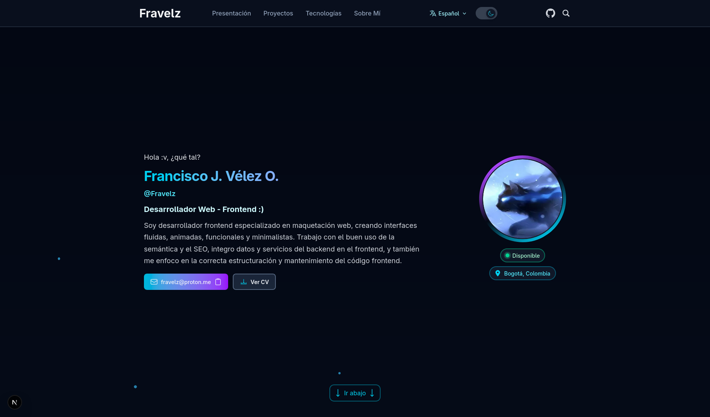

<!-- markdownlint-disable MD033 MD041 -->

<p align="center">
  <a href="README.md">Español</a> · <a href="README.en.md">English</a>
</p>

<h1 align="center">WEB-Fravelz</h1>

<p align="center">
  
</p>

<p align="center">Public portfolio: projects, CV, and contact in four languages.</p>

The site is at [fravelz.vercel.app](https://fravelz.vercel.app).
The root is not a page: it redirects to `/es`, `/en`, `/ru`, or `/zh`.

<p align="center">
  <a href="LICENSE"></a>
  <a href="https://github.com/FraVelz/WEB-Fravelz/actions/workflows/ci.yml">
    
  </a>
</p>

<p align="center">
  <a href="https://skillicons.dev">
    <picture>
      <source
        media="(prefers-color-scheme: dark)"
        srcset="https://skillicons.dev/icons?i=ts,react,nextjs,tailwind,pnpm,vercel,githubactions&theme=dark&perline=6"
      >
      <source
        media="(prefers-color-scheme: light)"
        srcset="https://skillicons.dev/icons?i=ts,react,nextjs,tailwind,pnpm,vercel,githubactions&theme=light&perline=6"
      >
      
    </picture>
  </a>
</p>

## Features

- Intro, projects, technologies, about, and contact.
- Each project carries an honesty badge: demo, pilot, lab, private, or finished.
- Four languages in the path: `es`, `en`, `ru`, and `zh`.
- Light theme, dark theme, or the system theme.

> [!NOTE]
> The previous Astro version lives on the `archive/astro` branch and the `astro-v1` tag. This tree is Next.js.

## Tech stack

- **Next.js 16, React 19, TypeScript, and Tailwind 4** — App Router and the interface.
- **GSAP** — hero motion, horizontal scroll, and the 404.
- **Sentry** — optional. With no DSN the client sends nothing.
- **Playwright** — accessibility smoke.
- **pnpm and Vercel** — local scripts and the public site.

## Quick start

```bash
pnpm install
pnpm dev
```

Open [http://localhost:3000](http://localhost:3000). CI uses Node 22 and pnpm 11.1.1.

> [!TIP]
> `pnpm dev` is enough. The public URL already falls back to `https://fravelz.vercel.app` if you skip `.env.example`.

## Usage

`/` redirects. Content lives at `/{lang}/`: intro, projects, technologies, about, and contact.
The CV opens in a PDF viewer. Contact is a `mailto:`.

> [!IMPORTANT]
> A new interface string goes into all four JSON files under `public/locals/`: `es`, `en`, `ru`, and `zh`.

Before a UI change: `pnpm lint`, `pnpm typecheck`, `pnpm format:check`, and `pnpm build`. The smoke is `pnpm test:e2e`.

## Contributing

The short guide is [CONTRIBUTING.md](CONTRIBUTING.md).
The bilingual detail is [docs/en/contribution.md](docs/en/contribution.md).

> [!WARNING]
> Do not commit `.env`. The tracked example is `.env.example`. A Sentry DSN stays out of the repository.

## License

MIT. The text is in [LICENSE](LICENSE).

## Documentation

- [Features](docs/en/features.md)
- [Structure](docs/en/structure.md)
- [Architecture](docs/en/architecture.md)
- [Tokens](docs/es/tokens.md)
- [Contributing](docs/en/contribution.md)
